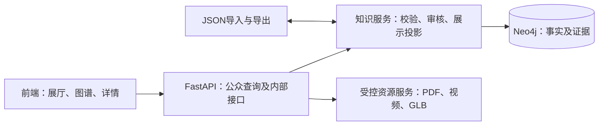

# 数据库与后端API实施准备

后续状态：用户已明确要求“开始”，本方案的本地数据库及API首版已实施，见[当前后端说明](../backend.md)。下文记录实施前的准备边界，不是当前未实施状态。

日期：2026-11-23。状态：**仅完成准备，尚未开始数据库或正式后端实现。**用户明确要求先准备、不开始。本轮不安装依赖、不启动容器、不建库、不导入、不调整已有预览服务、不修改知识数据，也不自动推送GitHub。

配套文件：[接口契约草案](../contracts/knowledge-api.v1.draft.openapi.json)、[基线与环境盘点](database-api-readiness-2026-11-23.json)。接口文件是设计文档，不是已运行接口或已生成的后端服务。

## 1. 何时可以开始

**现有知识已经足够作为首批数据库基线。**不必等所有资料提取完成，也不必等队友三维项目完整合并。股骹、窄篆及辔／马勒已完成本轮规范，稳定ID、事实证据、审核字段、校验规则和只读查询可复用。

初始输入：`data/candidates/knowledge.v0.11.json`、`data/ontology/ontology.v0.7.json`，配`data/sources/fusion-media.v0.11.json`。领域实体128、事实423、证据72、来源7、尺寸54项、模型映射7组；全部事实仍为pending，导入不能自动确认。

已有代码是JSON及内存查询，当前`/api/preview`等是临时检查接口，尚不是数据库API。用户后续明确要求启动实施后，再依本方案实际部署和编码。

## 2. 拟采用的技术与边界

- 一个Neo4j Community实例，Python通过官方驱动访问。
- FastAPI + Pydantic提供版本化REST接口，Uvicorn运行；具体依赖版本须在实施时验证兼容并锁定，不使用浮动latest镜像。
- 浏览器只访问后端，不直连Neo4j。知识写入以数据库为唯一运行时入口；JSON用于初始导入、备份、交接和版本导出。
- PDF、图片、视频和GLB仍保存为文件，数据库登记资源ID、内容哈希与受控地址。
- 保留既有JSON检查工具用于核验及回归；正式后端数据库断开时返回503，不能悄悄回退JSON并显示“数据库正常”。
- 现阶段不增加第二套业务数据库、Redis、消息队列、向量库或AI编排框架。AI问答后续复用知识服务。

## 3. 数据库中的稳定结构

领域本体和物理存储框架分开。以后增加一条装配解释、一个部件或一段证据，通常只新增记录，不改数据库结构。确有新实体类型或新关系语义时再迁移本体。

| 数据库记录 | 保存内容 |
| --- | --- |
| Entity | 领域实体，保存现有id、kind、label、aliases及适用范围 |
| Fact | 独立事实及稳定fact_id、predicate、origin、review_status、解释理由、抽取及审核记录 |
| Evidence | 证据原文、页码或时间段或词典义项、定位及适用范围 |
| Source | 文献、视频、辞书条目及资源登记信息 |
| ModelMapping | 实体、模型版本、节点索引及审核状态 |
| GraphState / ChangeSet / RecordRevision | 当前修订号、变更集、修改前后记录、操作人和原因 |

为当前记录建立通用Record.id唯一约束；按Entity.kind、名称、Fact.predicate及审核状态建立必要索引。类别、引用、尺寸、跨标本连接等业务规则继续由服务层和现有本体验证器约束，不假定社区版具备企业版的全部约束及细粒度权限。

### 事实和证据是主记录

以`Fact → SUBJECT → Entity`、`Fact → OBJECT → Entity`、`Fact → SUPPORTED_BY → Evidence → SOURCE → Source`保存实体关系断言。`basis_fact_ids`保存为事实间依据关联。`scope_id`表示适用对象，不自动解释为物理组成。

可以从事实派生`HAS_REGION`等直接关系，供图谱查询；每条派生边绑定fact_id，与事实在同一事务更新。派生边不是第二个编辑入口，允许从主事实重建。两个来源对同一对象的不同观点分别保留，不能靠MERGE覆盖成一个结论。

实体id和当前全部fact_id保留，包括已变成语境词义的`type:bridle`。路径查询仍区分教学导航与实物连接，不能通过材料或词义关系拼凑机械路径。

### 尺寸、嵌套字段与导出

Neo4j属性不能直接保存任意嵌套Map。尺寸仍是事实的字面值，分别保存quantity、unit、raw、approximate、value或min/max等可查询标量；对外再还原为现有结构化value对象。文字值单独保存，实体目标用OBJECT关联，三者互斥。

抽取、审核等字段展开为可查询属性或专门记录，来源、证据、映射分别建节点。审计可保存原始JSON快照，但不能只把整包JSON塞进一个数据库字段，就宣称完成数据库建设。

导出应保持现有0.4契约的含义、稳定ID、原始表达及证据引用；JSON对象字段顺序不作为语义相等条件。验证重点包括54项尺寸、两处榫卯、6项视频案例和全部来源定位。

### 三类版本与日常修订

- 数据v0.11：首批导入快照；后续正式导出再发行新数据版本。
- 本体0.7.0：当前概念、谓词和约束。
- 数据契约0.4.0：导入导出的字段格式。
- graph_revision：数据库每次成功变更后的修订号；日常补知识用它追踪，不要求每次写入都升级本体。

API区分baseline_dataset_id与当前graph_revision，避免把修改后的数据库误报成原v0.11完全未变。

## 4. 首次导入与增量维护

1. 只读校验固定基线及内容哈希，输出拟新增、修改、冲突和缺失资源清单。
2. 建立约束及初始GraphState，把全部合法候选导入数据库；不以“绝对确定”作为存储前提。
3. 同ID同内容重复导入无变化；同ID不同内容不能静默覆盖，必须提交显式变更集。
4. 增量变更集包含base_graph_revision、操作列表、幂等请求键和修改原因。先校验修改后的知识与依赖，再在事务内锁定并核对基线版本；变化则409并重新校验。
5. Entity、Fact、Evidence、Source、派生关系及修订日志要么整体成功，要么整体回滚。重试不能重复生成审核或变更记录。
6. 修改事实内容或关键证据时重新检查受影响的依赖，不自动沿用旧confirmed。审核接受推测后仍保留hypothesis/inferred及理由，不升级成绝对事实。
7. 不提供任意物理删除接口。撤回及回滚保留历史，通过新修订恢复或撤销，不擦除旧记录；有活动引用的来源不能被直接撤掉。

切换唯一编辑入口前导出JSON基线并保存可恢复的数据库备份。切换后外部JSON只能经过导入／变更集流程，不允许JSON和数据库各自独立修改。

## 5. API与前端的约定

以`/api/v1`为拟定正式前缀。既有临时`/api/preview`暂时保留，前端逐步切换；不要求队友立即重写三维页面。

| 拟定接口组 | 前端用途 |
| --- | --- |
| health/live、health/ready | 区分进程存活与数据库实际就绪 |
| meta | 当前修订、本体／契约版本及发布模式 |
| entities、entities/{id} | 搜索目录、查看结构化属性与描述 |
| graph | 全图或中心实体周边、关系组筛选及分页上限 |
| facts/{id}、facts/{id}/evidence | 点选关系查看事实、推测理由、页码和视频时间 |
| entities/{id}/model-mappings | 提供审核后可用的模型联动映射 |
| sources/{id} | 来源元数据，原件通过后续受控资源接口访问 |
| internal/snapshot、internal/paths/teaching | 内部完整核对与逐跳依据查询 |
| internal/change-sets | 新增、修订、审核知识，先验证再提交 |
| internal/export | 导出知识与本体用于交接 |

Graph返回nodes和edges，edge保留fact_id、predicate、origin、review_status、knowledge_basis及可追溯入口。public图的管理／分类筛选复用现有presentation规则。整体图只返回前端需要的图数据，不返回原始Neo4j内部节点ID。

普通分页采用page/page_size，稳定按业务ID排序；图展开depth上限3、节点limit上限500，返回truncated标记，不能把截断结果说成完整关系。不能向后端提交任意Cypher。教学路径接口仍只走SCHEMATIC_NEXT，最大16跳，找不到与实体不存在分开响应。

尺寸和描述仍随事实返回；前端不需要知道其物理数据库属性如何展开。证据响应显式区分pdf、video、dictionary_excerpt，不能假设都有pdf_page。公开响应与内部响应分别定义模型，不能只依赖前端隐藏字段。

错误至少区分：参数错误422、未认证401、无权操作403、不可见或不存在404、版本／内容冲突409、数据库不可用503。错误不暴露密码、连接串和服务器绝对路径；空结果不是服务失败。

## 6. 公众、内部、审核及演示

正式公众路由固定使用公众投影，不接受audience=internal或review=1绕过过滤。内部读取和全部写入需要服务端鉴权；Neo4j凭据只存在服务端，不能交给前端。

拟以服务端配置的操作员Bearer凭据提供首阶段内部访问，凭据与操作人绑定；审核者及提交时间由服务端确定，不能由请求体冒填。未配置鉴权时内部路由拒绝访问，不能默认放开。正式多用户登录可后续扩展。

数据库保存候选和已审核知识。正式公众默认confirmed_only；如课堂演示确需展示现有pending知识，必须由服务端显式配置candidate_preview，并在响应与页面持续标明。不能由公众查询参数自行开启。confirmed仅表示项目审核接受，推测仍是推测。当前423条pending不因导入变成已审核。

课程演示先本机单实例；对外部署前再核实前端来源、凭据配置及原件共享范围。现有用途切换只是展示筛选，不能当作已完成鉴权。

## 7. 实施顺序与验收

| 顺序 | 以后实施的内容 | 完成证据 |
| --- | --- | --- |
| 1 | 核对Docker守护进程、镜像及驱动兼容，锁版本，配置持久目录 | 数据库真实连接与重启后存活 |
| 2 | 存储适配及v0.11首次导入 | 基线记录逐条对照、重复导入零重复、导出含义一致 |
| 3 | 正式只读API、公众／内部鉴权和来源定位 | 前端从数据库查询；断库明确503，无JSON假回退 |
| 4 | 增量变更、审核、冲突和历史记录 | 新知识即时可查、旧修订可追、并发过期提交409、失败整批回滚 |
| 5 | 图谱和三维前端联调 | 选择实体→属性／证据→有效模型映射；公众管理边不泄入图中 |

具体回归样例：CH1：5股／骹保持区域和原尺寸；两处榫卯不跨标本；窄篆仍13道；辔的三个语境不误并；视频推测保留时间及性质；车轮至舆的4段教学路径逐跳保留依据；内部完整关系233条、现行公众投影76条；7组映射仍按实际审核状态处理。

数据库总节点数将多于128，因为事实、证据、来源及审计也占节点。128是领域Entity数量，不是数据库全部节点总数。

本方案完成后才算“可持续维护的数据库与后端”，只导入一次JSON或写几个能返回固定数据的接口不能算完成。

## 8. 环境准备情况与实际未做事项

只读盘点发现Python 3.13.11；当前解释器可发现FastAPI 0.135.3、Pydantic 2.12.4、Uvicorn 0.44.0，但项目尚未锁定这些依赖。Docker和Java命令在PATH，Neo4j命令与Python驱动未发现。发现命令不等于服务已运行；本轮没有执行docker info、拉镜像、启动数据库或安装驱动。

现有公众展示规则等修改仍有本地未提交内容，后续实施时先明确实际Git基线。准备稿只新增文档和接口设计，不改变运行代码、知识文件或正在运行的服务。

## 9. 已核对的官方依据

- [Neo4j属性类型](https://neo4j.com/docs/cypher-manual/current/values-and-types/property-structural-constructed/)：标量及受支持列表与任意嵌套Map需区分。
- [Neo4j事务](https://neo4j.com/docs/python-manual/current/transactions/)：原子提交、回滚及重试下的幂等要求。
- [Neo4j版本功能差异](https://neo4j.com/docs/cypher-manual/25/introduction/cypher-neo4j/)：不依赖企业版专有的细粒度权限和约束。
- [FastAPI响应模型](https://fastapi.tiangolo.com/tutorial/response-model/)：输出验证、序列化和OpenAPI描述；公众／内部仍需明确独立模型和鉴权。

链接用于本次设计核对，具体软件版本在获准实施后再验证锁定。外部网页里的安装指令不构成本轮执行授权。
