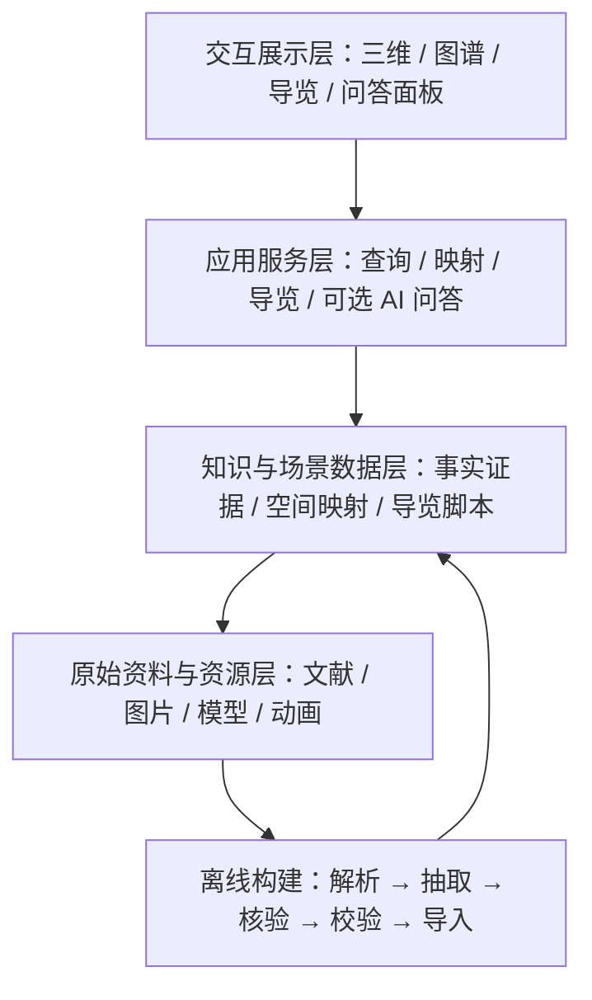

# 楚国战车专题交互导览系统：软件计划设计书

版本：v0.1｜日期：2026-11-18｜状态：组内评审稿

用途：供组员讨论软件边界、理解系统结构，并按阶段接力开发。本文描述计划与拟定验收标准，不表示功能已经实现。

执行更新（2026-11-19）：已开始 P1 知识层初版，具体可运行内容见 README 与 `docs/architecture.md`，最新检查和待办见 progress/handover。本文中的阶段表仍是计划，不代表阶段全部完成。

## 1. 项目定位与讨论结论

暂定名称：**面向楚国战车专题展陈的知识图谱与三维交互导览系统**。

面向博物馆专题介绍场景，围绕“认识展品—探索部件—理解结构—查看依据”组织体验。知识图谱是内容基础，三维模型是观察与定位载体，专题导览将知识和展示串联起来，AI 问答作为加分项。

### 1.1 已明确的方向

- 最终交付一个可展示、可操作的知识系统；知识图谱构建是重点。
- 前端展示与知识应用同样重要，要让用户看懂图谱中的知识。
- 已有三维模型可以作为起点，但正确性和完整性尚未核验；不能把模型几何当作文献事实。
- 三维与知识通过讲解、交互和专题演示建立关联。
- AI 问答属于加分项，不作为基础功能运行条件。
- 采用接力开发：每次一名开发者修改共享开发线，完成检查和文档后交给下一位。
- 从知识层构建开始，由项目发起者先承担这一阶段。

### 1.2 本文提出的默认方案

以下为实施建议，尚未全部经小组确认：以九连墩六号车为主展品；先完成车轮与车轴的局部闭环；采用四个逻辑层和独立离线流程；先用规范 JSON 建立知识基线；优先本机演示。

原始说明保存在 [AGENT_BUILD_BRIEF.md](AGENT_BUILD_BRIEF.md)。本文细化架构、协作和阶段交付，不删除其中的原始需求。需要改变功能范围时，必须在需求表和决策记录中明确说明。

## 2. 展示场景与使用方式

| 场景 | 用户操作 | 系统反馈 |
|---|---|---|
| 自由观察 | 旋转、缩放模型，点击可选部件 | 高亮对象，展示名称、知识和核验状态 |
| 知识探索 | 搜索名称、查看图谱、展开相邻关系 | 展示关联实体、关系解释、事实和证据 |
| 双向定位 | 从模型进入图谱，或从图谱定位模型 | 同步选择；没有映射时明确提示 |
| 专题导览 | 进入专题，逐步观看或播放 | 切换讲解、镜头、高亮及结构演示 |
| 查阅依据 | 打开某条事实的来源 | 展示文献名称、页码/图号、证据片段及资源可用状态 |
| AI 问答（加分） | 输入与展品有关的问题 | 检索后回答，附证据和相关实体；不足时说明限制 |

一个建议的首个专题是“认识车轮与车轴的结构关系”。其具体部件名称、连接解释与尺寸必须来自资料核查；讲解顺序不是历史装配顺序。

## 3. 范围与需求边界

### 3.1 分期范围

| 范围 | 计划内容 | 完成口径 |
|---|---|---|
| 第一阶段：知识基础 | 来源登记、本体、事实证据、小样例、校验、查询示例 | 下一位可复现数据检查并据此开发后端 |
| 首个可演示版本 | 整体模型、局部知识、图谱与三维联动、局部爆炸和步骤演示、一个专题导览 | 能走完一条真实、有来源的用户路径 |
| 最终基础系统（提议） | 扩展经资料支持的主要部件，完善展陈页面、专题及运行交付 | 功能和内容按冻结后的验收清单检查 |
| 加分项 | 带证据的 AI 问答；有配置与授权时开展 AI 抽取/Gleaning 实验 | 与基础功能独立验收，失败不影响基础浏览 |
| 暂不默认承担 | 整车精细重建、工程级物理仿真、自动生成并保证可行的装配路径、完整 OWL 推理系统 | 如确有课程需要，另行评估和立项 |

“主要部件”以来源核查后的覆盖清单定义，记录已覆盖、待核验、缺失依据和无模型映射，不以任意节点数量充当质量指标。

### 3.2 需求追踪

以下状态均为**计划状态**，不是完成状态。课程强制要求尚需小组核对，不能把“后续”直接当作取消。

| 编号 | 需求 | 当前计划 | 验收重点 |
|---|---|---|---|
| R01 | 知识图谱构建与浏览 | 核心 | 可检索、关系可解释、事实可追溯 |
| R02 | 整体三维展示与部件选择 | 核心 | 模型可加载、选择可靠、映射缺失有提示 |
| R03 | 图谱和三维双向联动 | 核心 | 两端定位一致，避免选择事件循环 |
| R04 | 结构爆炸图 | 首轮先做局部 | 展开和复位不累积漂移 |
| R05 | 拼装过程、车轮组装 | 首轮局部步骤演示，最终深度待定 | 播放/暂停或逐步查看；假设顺序可见 |
| R06 | 车箱与车轴连接 | 原始需求保留，排期和演示深度待定 | 区分连接事实与演示动作 |
| R07 | 马匹与车体连接 | 原始需求保留，排期和模型能力待定 | 来源、部件和示意范围明确 |
| R08 | 绳索穿引 | 原始需求保留，实现方式待定 | 路径有依据或显式标为假设 |
| R09 | 行驶演示 | 原始需求保留，最终深度待定 | 示意运动不冒充动力学验证 |
| R10 | 专题导览 | 核心方案，专题数量待定 | 知识、模型与讲解形成完整路径 |
| R11 | AI 问答 | 加分项 | 有证据、能关联实体、能说明未知 |
| R12 | 运行、文档和课程交付 | 核心 | 接手者可运行、可检查、可解释限制 |
| R13 | 前后端分离 | 小组实现要求 | 页面与服务代码分别位于 `frontend/` 和 `backend/`，通过有文档的 HTTP API 对接，能够分别启动和验证 |

## 4. 总体架构

采用四个逻辑层。正式实现采用前后端分离，两部分放在同一仓库，通过第 6 节的 HTTP API 对接。

- `frontend/` 负责页面、交互、图谱与三维渲染。展陈数据和资源地址通过 API 获取。前端开发可以先使用符合接口契约的样例响应。
- `backend/` 负责 HTTP 接口、请求校验、资源访问和审核状态过滤，通过 `chuchariot/` 包查询知识。知识校验与数据存储由服务端统一处理。
- 验收时分别检查前端启动、后端接口和联调。数据格式、错误响应和可用状态统一记录在 [接口文档](api.md)。



不支持 Mermaid 的阅读器可按“展示层 → 应用服务层 → 知识与场景数据层 → 资源层”理解；离线流程从资源产生核验后的知识。

### 4.1 原始资料与资源层

保存文献、图片、模型、动画及资源元数据。原件不覆盖，派生文件另存。登记稳定资源 ID、文件名、类型、版本、可用性、共享方式及校验值（实际计算后填写）。

网站与脚本通过配置定位资源；运行时不能依赖某个组员电脑的绝对路径。未入仓资源提供获取、放置和缺失提示说明，不把整个父目录作为仓库上传。

### 4.2 知识与场景数据层

| 数据组 | 保存内容 | 边界 |
|---|---|---|
| 语义知识 | 类别、部件实例、组成、连接、尺寸、事实、证据、核验状态 | 知识的含义和依据 |
| 场景与演示配置 | 模型版本、节点映射、坐标、位姿、爆炸偏移、装配步骤 | 数字模型如何展示，不自动成为历史事实 |
| 导览内容 | 专题、段落、引用事实、关联实体、镜头和演示动作 | 内容编排，不另造一套无来源知识 |

推荐以版本化 JSON 作为首轮交换格式及可核查的数据基线。若接入 Neo4j，通过适配层将核验数据幂等导入；明确唯一编辑入口，避免 JSON 与数据库分别修改后互相覆盖。最终是否必须接入 Neo4j 属于待确认项。

### 4.3 应用服务层

Python 后端负责输入校验、知识查询、来源定位、场景配置、导览内容和可选问答。后端返回实体/事实 ID 与展示配置，不逐帧控制三维对象。

AI 调用封装在独立模块中。无密钥时正常提供基础查询与预设导览；问答结果不直接写入正式知识库。不得将数据库凭据和 AI 密钥交给浏览器。

### 4.4 交互展示层

前端提供展品入口、三维查看区、知识与证据面板、图谱视图、导览控制和可选问答面板。先审查并复用已有 HTML 和三维实现，再决定是否引入框架。

前端执行镜头、高亮、爆炸和动画，维护统一选择状态。用稳定实体 ID 联动视图；界面区分“有知识无几何”“有几何待核验”“无有效映射”等状态。

### 4.5 离线知识构建流程

独立执行：资料登记 → 文本/图表解析 → 候选抽取 → 可选 Gleaning → 规范化与冲突整理 → 人工审核 → 校验 → 导入。

网站启动和用户查询不触发重新抽取。人工整理/导入是一条正式可用路径。Gleaning 默认最多一轮额外补抽，保留首轮结果、证据定位、去重结果和运行记录；未配置时标记跳过。真实外部 AI 处理原始资料前，按原始说明确认处理授权。

## 5. 知识层与跨模块契约

本节是 P1 阶段的设计起点，不是已经实现的数据规范。P1 交接前须将确定的字段、样例和校验规则落入 `docs/data-model.md` 及机器可读约束。

### 5.1 对象与区分原则

- 知识对象：`ComponentType`、`Chariot`、`Component`、`Measurement`、`Connection`。
- 来源对象：`SourceDocument`、`Evidence`、`Fact`。
- 数字资源对象：`Resource`、`ModelVersion`、`ModelMapping`、`Pose`。
- 内容与演示对象：`AssemblyStep`、`Tour`、`TourStep`。
- 类别与实例、历史实物与模型版本、文献尺寸与模型采用尺寸必须分开。
- 直接组成、场景父子关系、装配步骤依赖和导览顺序分别建模。

关系至少沿用原始说明中的组成、类别、尺寸、连接、证据、模型表示和步骤依赖，并定义中文含义、方向、两端类型及适用约束。`HAS_PART` 表示直接组成；查询不到不等于关系不存在。

### 5.2 事实与证据

推荐以独立 `Fact` 记录作为需追溯断言的统一入口，关系视图由事实投影；不要再维护一套可独立修改的重复关系数据。

| 字段组 | 建议内容 |
|---|---|
| 标识 | `fact_id`、`subject_id`、`predicate`；稳定 ID 不随名称改变 |
| 断言值 | `object_id` 或结构化 `value`，二者按谓词规则互斥 |
| 适用范围 | 实物/类别范围、所属研究对象；防止一般知识误归属到具体战车 |
| 依据 | `evidence_ids`；推导/假设另存 `basis_fact_ids` 和解释，不伪装成直接引文 |
| 性质 | `origin`：`documented` / `inferred` / `hypothesis` |
| 审核 | `review_status`：`pending` / `confirmed` / `disputed`，以及审核者、日期、备注 |
| 产生方式 | 人工/工具/模型抽取方式、批次标识和可获得的版本信息 |

`confirmed` 表示已按本项目审核规则核对，不表示获得考古权威认证；`hypothesis` 经审核后仍是复原假设。需原文支撑的事实必须能回到证据片段和页码/图号；无充分依据的候选保留在待审核区。

证据记录包含文献 ID、PDF 页码（与印刷页码分开）、可选图号、文本或图像定位、核对状态。尺寸保留原始表达，数值/范围、单位和近似标记分开；未知字段缺省或使用规范定义的空值，不填零凑数。

### 5.3 模型映射与演示

映射至少包含实体 ID、模型版本 ID、节点选择器、映射状态和核验说明，允许一对多。模型节点选择器必须在实查后确定；不能只凭重名节点绑定。

位姿和偏移注明单位、坐标系、局部/世界空间、旋转表示及状态。演示以保存的初始位姿计算，反复展开和复位不能叠加位移。未映射对象可以先保留知识，不能编造节点占位后宣称完成联动。

### 5.4 导览内容

`TourStep` 建议包含步骤 ID、讲解文本、`entity_ids`、`fact_ids`、证据引用，以及可选镜头/高亮/演示动作。自然语言讲解需与引用事实一致；解释性推测显式标注。

导览可提供“下一步/上一步”模式，自动播放作为增强。预设专题不依赖 AI 生成；AI 日后可辅助回答或调整解释，但不能绕过证据约束。

## 6. 应用接口与技术约定

默认后端采用 FastAPI/Pydantic；三维优先复用现有实现，必要时使用 Three.js。依赖版本在实际安装验证后记录，不在计划书中假定已兼容。

以下为拟定接口，均尚未实现；后端阶段在 `docs/api.md` 和自动生成的 API 文档中固化。

| 接口 | 用途 | 阶段 |
|---|---|---|
| `GET /api/health` | 服务及存储状态；AI 配置仅报告可用性 | P2 |
| `GET /api/entities?type=&q=` | 实体检索 | P2 |
| `GET /api/entities/{id}` | 详情、事实和核验状态 | P2 |
| `GET /api/entities/{id}/relations` | 关系及相邻实体 | P2 |
| `GET /api/entities/{id}/evidence` | 事实关联的证据和来源 | P2 |
| `GET /api/entities/{id}/model-mappings` | 映射及可用状态 | P2，P3 核验 |
| `GET /api/scenes/{id}` | 资源、坐标及演示配置 | P3 |
| `GET /api/assembly-plans/{id}` | 局部步骤和依据性质 | P3/P4 |
| `GET /api/tours/{id}` | 专题内容和步骤 | P4 |
| `POST /api/qa` | 可选知识问答 | P5 |

接口统一约定：稳定 ID、相对资源 URL、保留事实与审核状态；未知实体返回明确的 404；实体存在但无映射/证据时返回空集合和状态，不混同为实体不存在。固定排序，数据量增加时补分页；查询错误与服务不可用要可区分。

允许合并接口以减少复杂度，但更改接口必须同步调用方、样例和文档。问答结果建议返回回答、实体 ID、事实 ID、证据和不足说明；配置缺失时返回可识别的功能未启用状态。

## 7. 串行开发阶段与交接点

阶段表示工作顺序，不等于人数；同一组员可承担多个阶段。除 P1 发起者外，人员与日期均待分配，不虚构工期承诺。

| 阶段 | 工作包 | 主要输入 | 必须交付 | 交接验收 |
|---|---|---|---|---|
| P0 | 计划与约定 | 初步说明、组内讨论 | 本设计书、决策/进度/交接记录 | 区分共识、建议和待定项；目前仅完成文档准备 |
| P1 | 知识层构建；发起者先做 | 原始资料、现有模型和 HTML | 来源清单、本体与约束、核验小样例、覆盖清单、校验与查询工具、数据文档 | 不启动前端也能复现查询和证据追踪；交接包完整 |
| P2 | 后端知识服务 | P1 数据契约与样例 | 查询接口、存储适配、必要接口测试、启动说明 | 无 AI 配置可启动；接口状态、引用和结果正确 |
| P3 | 前端与三维联动 | P2 接口、模型调查结果 | 展示页、图谱视图、映射、双向选择、局部爆炸/复位 | 浏览器实查通过；缺失映射、模型缺失有反馈 |
| P4 | 专题导览与演示集成 | P3 功能、核验事实 | 完整专题、步骤控制、局部装配演示、联动状态管理 | 从讲解进入知识/模型/来源；切换与复位稳定 |
| P5 | AI 加分项，可跳过 | 已稳定的知识与证据服务 | 检索问答、引用验证、可选抽取/Gleaning 实验记录 | 回答可追溯、无依据不编造、失败可降级 |
| P6 | 最终验收与交付 | P4 或 P5 稳定版本、冻结范围 | 回归记录、可运行交付包、报告素材、演示脚本 | 新环境可复现；逐项说明完成、未完成与限制 |

P6 可以在跳过 P5 的情况下开展。内容扩展和原始动画需求按范围决策插入 P3/P4 或后续工作包，不暗中增加到 P1。

### 7.1 P1 的具体工作顺序

1. **调查和登记。** 阅读原始资料，登记来源与资源；记录 PDF 页码规则。初查 GLB 节点/动画及旧 HTML 的实现方式，给后续映射提供线索，不要求此时完成前端。
2. **划定局部。** 优先评估车轮/车轴资料，列出真实可证实的对象与知识缺口。证据不足时缩小样例范围并说明原因。
3. **固定数据契约。** 确认对象、关系、ID、单位、事实证据、审核及版本字段，建立机器可检查的格式。
4. **人工做通小样例。** 先产出可核查的数据闭环，再考虑 AI 批量抽取；候选、冲突和核验后数据分开。
5. **实现校验与查询。** 校验 ID/引用/类型/单位/组成和依赖循环；提供命令行查询样例，证明无需网页也能读取知识。
6. **准备导入与重跑。** 明确源数据和派生存储的关系；重复导入不产生重复记录。若尚无数据库，验证规范数据重载一致性，不宣称已接入 Neo4j。
7. **更新交接资料。** 固定一个数据契约版本，提供运行命令、预期结果、未解决项和后端对接建议。

### 7.2 P1 交付包与通过条件

| 交付物 | 内容 | 通过条件 |
|---|---|---|
| 来源/资源清单 | 文献、模型、权限/放置说明、可用状态 | 每项能定位；未共享资源有明确准备方法 |
| 本体与数据规范 | 类型、关系方向、字段、ID、单位、事实与审核规则 | 样例通过约束；字段含义无歧义 |
| 有依据的小样例 | 核验后的局部实体、事实和证据 | 关键事实可定位到原文；不以虚构数量充数 |
| 覆盖与问题清单 | 已覆盖、待核验、冲突、缺失知识、映射线索 | 资料缺口与模型缺口可区分 |
| 校验与查询工具 | 可复制命令、实际依赖、必要测试 | 有效样例通过，错误引用/非法关系能被检出 |
| 管线说明 | 人工路径、可选 AI/Gleaning、日志与重跑方式 | 未启用部分明确标记；首轮结果不会因补抽失败丢失 |
| 接力交接 | 当前状态、版本、命令、结果、下一步 | 接手者按文档独立复现 |

P1 不以漂亮网页、全车精细模型或 AI 调用数量作为完成条件。校验通过也不等于历史事实已被证明，必须同时保留内容审核。

## 8. 串行接力开发制度

### 8.1 工作权与 Git 规则

- 每次只安排一名开发者进入修改阶段，其他人可以阅读和评审；下一位在交接完成后开始修改。
- 工作权通过组内约定及 `docs/handover.md` 记录，不把它误认为自动文件锁。
- 当前仓库默认分支为 `master`。小组可保留该名称；是否改名不影响接力流程。为本项目默认采用单条共享开发线，避免每人长期分支后集中合并。
- 每个独立可验证阶段形成提交；提交信息写清阶段和变更。提交前审查 diff，按文件暂存，避免误提交凭据和原始大文件。
- 远程协作仅在远程仓库配置和共享范围确认后启用。拉取使用快进方式；出现分叉或冲突先保存现场并协商，不通过强推、硬重置覆盖同学工作。
- 跨阶段改动允许进行，但须同时更新受影响规范、调用方和检查；重大数据格式变更先写迁移方案。

### 8.2 接手流程

1. 确认前一位已交接，再检查 `git status`；不要覆盖未知的本地改动。
2. 有远程跟踪分支时同步最新提交，记录收到的提交号；未配置远程时按约定的本地交付方式接手。
3. 按 README → 交接索引中的最新个人记录 → 软件计划 → 当前阶段规范的顺序阅读。
4. 执行前一位留下的实际检查命令，记录自己的复现结果。
5. 基线复现成功后认领当前工作包；失败先登记问题，修复或回交后再扩展。

### 8.3 交出流程

1. 停止新增范围，完成本阶段必要检查。
2. 同步受影响文档、依赖、数据和运行命令；标出未通过和未执行的检查。
3. 新建本轮的署名交接文档，记录完成项、检查结果、已知问题和下一项任务，并更新交接索引及进度记录。
4. 审查并提交本阶段内容；若允许远程共享，再推送并向接手者提供提交号。
5. 接手者复现并确认后转移工作权；原开发者停止修改共享开发线。

交接文档写本轮基线提交号；交付提交号由接手者通过 `git rev-parse HEAD` 获取并记录，避免在文件中追写包含它自身的提交哈希。失败或中断时保留实际工作状态，不把“已交出”写成“验收通过”。

### 8.4 交接记录最少字段

日期、交出者/接手者、工作包、基线提交、数据/API 契约版本、变更文件、环境与依赖、运行/停止方式、检查命令及结果、资源准备、已知问题、下一项任务、接收复现结果。

## 9. 工程目录和文档职责

以下是目标结构。P1 已增加可复用的根目录 Python 包 `chuchariot/`；后续 `backend/` 可调用该包，不必把知识逻辑复制一份。实际已创建内容见 architecture。

```text
ChuChariot/
  chuchariot/              # 已实现的知识校验、查询、资源检查和 CLI
  backend/                 # API、应用服务、存储适配、AI 调用封装
  frontend/                # 页面、三维、图谱、导览播放器
  scripts/                 # 离线解析、抽取、审核辅助、校验、导入
  data/
    ontology/              # 本体与格式约束
    sources/               # 来源与证据索引
    candidates/            # 待核验候选
    verified/              # 核验后的规范数据
    scenes/                # 映射、坐标、位姿与演示
    tours/                 # 引用知识的专题内容
    runs/                  # 本地运行日志，不默认入仓
    run-summaries/         # 经脱敏、可共享的实验摘要
  assets/                  # 按共享规则准备的运行资源
  docs/
  tests/
  README.md
```

| 文档 | 维护内容 | 首次落地阶段 |
|---|---|---|
| `README.md` | 当前入口、安装/运行、资源准备、限制 | P0 建入口，之后持续更新 |
| `docs/software-plan.md` | 定位、范围、阶段与接力规则 | P0 |
| `docs/architecture.md` | 实际模块、数据流、代码入口 | P1 建最小实际说明，P2/P3 补实现 |
| `docs/data-model.md` | 确定的本体、字段、版本和迁移 | P1 |
| `docs/sources.md` | 来源清单、使用范围、资源准备与缺口 | P1 |
| `docs/pipeline.md` | 实际命令、输入输出、人工路径、Gleaning 和日志 | P1 |
| `docs/api.md` | 已实现接口、示例、错误及契约版本 | P2；此前接口草案见本文第 6 节 |
| `docs/progress.md` | 追加式阶段记录与真实验证结果 | P0 |
| `docs/decisions.md` | 方案背景、决定、状态、影响和替换条件 | P0 |
| `docs/handover.md` | 从新到旧索引历次署名交接文档 | 每次交出时更新 |
| `docs/handovers/署名-交接文档-YYYY-MM-DD.md` | 本轮交接记录、可接手状态与复现路径 | 每次交出时新建 |

规范、进度和交接文档随实现同批提交。运行日志保存机器可读记录，不把大段输出堆进 progress；有价值的批次摘要脱敏后随实验交付，完整本地记录按授权方式移交。

## 10. 检查与最终验收

### 10.1 各阶段必要检查

- **数据：** 唯一 ID、引用完整性、关系两端类型、单位与范围、类别/直接组成/步骤依赖的非预期循环、证据定位、冲突保留。
- **内容：** 抽样回查原始页码和图像，核对对象归属；图中内容须实际检查，文本解析不代替读图。
- **导入：** 对同一输入重复运行，节点/事实不重复；变更版本时有明确更新策略。
- **接口：** 核心查询、过滤、未知 ID、无映射、无 AI 配置、资源缺失等分支。
- **浏览器：** 加载、选择与反选、双向定位、爆炸/复位反复操作、步骤切换、导览退出与状态恢复。
- **交接：** 下一位根据文档复现；未执行部分保留为未验证。

### 10.2 最终基础系统验收建议

1. 按文档在约定环境运行，无 AI 密钥也能完成核心展示。
2. 能沿一条完整路径操作：进入展品 → 专题/部件 → 图谱知识 → 三维定位 → 事实证据。
3. 正式展示内容的来源、性质和审核状态可识别；不把假设或未知包装为确定事实。
4. 对冻结后的 R01—R13 逐项给出结果和证据，不能用计划代替成果。
5. 演示状态稳定，数据缺失和模型缺失有可理解的反馈。
6. 代码、规范、实际依赖、资源准备、必要检查、已知问题和接手说明齐全。

AI 功能另行验收：证据支持度、引用有效性、相关实体定位、无答案/冲突/服务失败表现。若评估 Gleaning，用人工核验样本比较遗漏、错误、用量和耗时，不只比较新增数量。

## 11. 风险与应对

| 风险 | 应对 | 对交付的影响 |
|---|---|---|
| 来源不足或冲突 | 缩小已确认范围，保留候选与分歧 | 不能承诺完整历史装配说明 |
| GLB 无法按语义选择或缺部件 | 先调查；必要时使用标注清楚的简化局部模型 | 映射与精细动画可能延期 |
| 导览文本与事实分离 | 以实体/事实 ID 引用，变更时检查引用 | 增加内容维护约束 |
| 数据格式频繁变化 | P1 交接冻结版本，后续变更附迁移说明 | 避免后端与前端反复返工 |
| AI 不可用或结果失真 | 基础功能独立；候选审核；证据约束 | 加分项不阻断主系统 |
| 接力期间环境不同 | 固定实际依赖，提供资源准备和复现命令 | 每次交接都需要接收检查 |
| 演示依赖外部 CDN | 若要求断网，将依赖资源本地化并实际验收 | 是否离线需提前确定 |
| 原始资料共享权限不明 | 只登记元数据，按授权共享；不默认上传 | 克隆后可能需要额外准备资源 |

## 12. 待小组确认的事项

这些事项不阻止 P1 开始，但应在对应阶段前确定，并写入 decisions。

| 事项 | 建议/当前状态 | 最晚确认点 |
|---|---|---|
| 展陈对象 | 建议以九连墩六号车为主，楚国战车一般知识作为背景；尚未确认 | P1 确定资料范围时 |
| 最终功能深度 | R06—R09 保留，需核对课程要求并排定范围 | P3 前 |
| 图数据库 | JSON 首轮可用，Neo4j 最终是否必交待确认 | P2 存储实现前 |
| 运行环境 | 建议 Windows 本机；断网与服务器部署要求未定 | P2/P3 前 |
| 人数与负责人 | P1 发起者先做，其余待分配 | 对应阶段开始前 |
| 日期与工期 | 截止日期未知，不预排日历工期 | 排期前 |
| 资料与模型共享 | 普通 Git、LFS 或外部准备方式未定 | 首次共享资源前 |
| AI 配置与授权 | 问答选做；供应商、预算、资料处理授权未定 | 真实外部调用前 |
| 报告和答辩分工 | 软件提供截图、架构、实验及演示素材；正文/PPT/录屏责任待定 | P6 前 |

## 13. 当前状态与近期行动

截至 2026-11-19，P1 的资源登记、校验查询、重复导入和第三批提取可复现。临时只读检查页提供候选、PDF 图块和 GLB 节点静态图的联查。正式事实待人工复核，生产后端、交互式三维、Neo4j 和 AI 问答属于后续阶段。查看[现状与文档索引](index.md)。

近期按顺序开展：复核候选及对照标本归属 → 追查原始报告 → 形成首批正式知识并补齐局部连接依据 → 完成 P1 交接包 → P2 后端接口。展陈范围、最终动画深度、工期与后续负责人仍按第 12 节确认。
